<p align="center">English | <a href="README.tr.md">Türkçe</a></p>

<br>

ParkinVox is a project to detect signs of Parkinson's disease from speech using machine learning. It is built in two stages: a toolkit that extracts and measures voice features, and classifiers trained on those measurements.

> **Status: work in progress.** Stage 1, the feature toolkit, is finished and validated against Praat on 208 recordings. The actual ML part is not done yet.

[Install](#install) / [Usage](#usage) / [Validation](#validation) / [Limitations](#limitations) / [Roadmap](#roadmap)

> **WARNING:** ParkinVox measures voice signals. It does not diagnose Parkinson's disease and it should not be used as a replacement for a doctor.

<br>

<a id="why"></a>
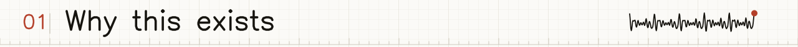

Voice changes are one of the early signs of Parkinson's disease, and many studies analyze them with features such as jitter, shimmer, HNR and formants. But tools implement these features differently, so the results are hard to compare, and a classifier is only as trustworthy as the features it is trained on.

ParkinVox starts from the features. It computes them in plain NumPy and librosa and checks each one against Praat, the main reference tool in phonetics. The next stage trains machine-learning models on these measurements using public Parkinson's speech datasets and evaluates them speaker by speaker, so that the results are not inflated.

<br>

<a id="measures"></a>
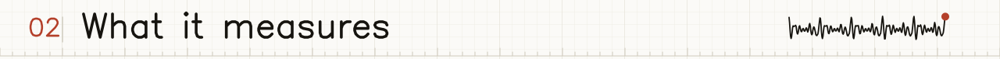

| Group | Measurements | Recording tasks |
|---|---|---|
| Quality (`qc_`) | peak and RMS level, DC offset, clipping and silence fractions, quality flags | all |
| Phonation (`phon_`) | F0 statistics, jitter (local, RAP, PPQ5), shimmer (local, APQ3/5/11), HNR, CPPS approximation, intensity | sustained vowel |
| Articulation (`art_`) | F1 to F3, MFCCs and deltas, spectral centroid, bandwidth, rolloff, flatness, vowel space area, VAI, FCR | all |
| Nonlinear (`nonlinear_`) | DFA, permutation entropy, PPE, recurrence rate and determinism | sustained vowel |
| Timing (`time_`) | syllable nuclei, syllable rate, interval mean, standard deviation, CV and slope | DDK, reading, spontaneous |
| Prosody (`pros_`) | pauses, F0 range, intensity range, speech rate, articulation rate | reading, spontaneous |

Jitter and shimmer are measured cycle by cycle. ParkinVox traces individual glottal cycles with pitch-synchronous cross-correlation and parabolic peak refinement, and skips cycle pairs that differ by more than 1.3 in period or 1.6 in amplitude, as Praat does. HNR uses a window-corrected autocorrelation. Formants use Burg LPC on 25 ms frames, with the ceiling capped at the recording's Nyquist frequency.

<br>

<a id="install"></a>
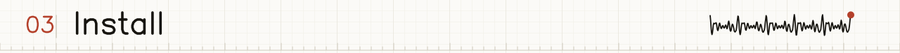

```bash
python -m venv .venv
source .venv/bin/activate
python -m pip install -e ".[test,validation]"
```

On Windows, activate with `.venv\Scripts\activate`. Python 3.11 or newer is required.

<br>

<a id="usage"></a>
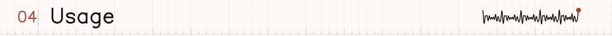

```python
from parkinvox_src import extract_voice_features

features = extract_voice_features("recording.wav", task="sustained_vowel")
print(features["phon_jitter_local"], features["phon_hnr_db"])
```

The supported tasks are `sustained_vowel`, `ddk`, `reading` and `spontaneous`. The function returns a flat dictionary of numbers and flags. Check the `qc_` flags before trusting a result. Settings such as the F0 range and formant options are in `ExtractionConfig`:

```python
from parkinvox_src import ExtractionConfig, extract_voice_features

config = ExtractionConfig(minimum_f0_hz=60.0, maximum_f0_hz=400.0)
features = extract_voice_features("recording.wav", task="sustained_vowel", config=config)
```

<br>

<a id="validation"></a>
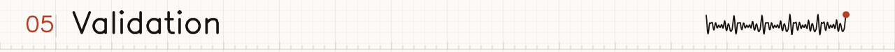

Sustained-vowel measurements were compared with Praat, through Parselmouth, on 208 recordings from the [VOICED database](https://physionet.org/content/voiced/1.0.0/). All acceptance checks in `validation/validate_praat.py` pass.

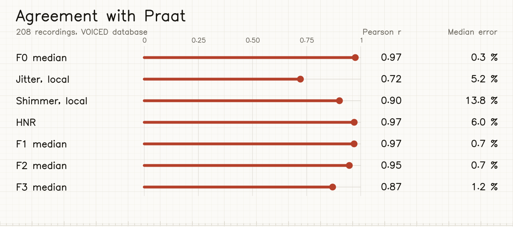

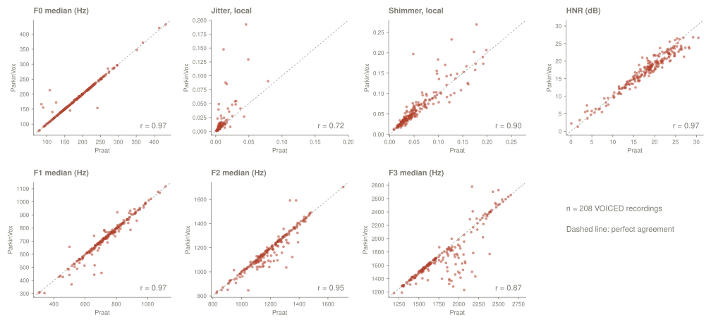

Per-file results are in `validation/results/voiced_after_fix.csv`. To reproduce:

```bash
python scripts/download_voiced.py
python validation/validate_praat.py validation_audio --output validation_results.csv
```

<br>

<a id="limitations"></a>
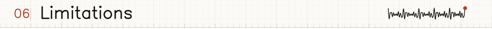

- The validation shows agreement with Praat only. It says nothing yet about detecting Parkinson's disease and no model has been trained yet.
- VOICED contains healthy and other voice-disorder recordings, not a Parkinson's cohort.
- Jitter agreement is weaker on strongly pathological voices, where cycle tracking is harder (r = 0.72 overall, Spearman 0.94).
- The VOICED files are 8 kHz, so the formant ceiling is capped at 4 kHz.
- The CPPS value is an approximation, not a replacement for Praat's CPPS.
- The final models will be trained on public datasets and have not been tested on patients.

<br>

<a id="roadmap"></a>
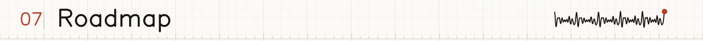

- [x] Feature extraction for sustained vowels, DDK, reading and spontaneous speech
- [x] Validation of jitter, shimmer, HNR and formants against Praat
- [x] Synthetic tests with known jitter and shimmer
- [ ] Choose and download a public Parkinson's speech dataset
- [ ] Extract features for every recording and check for recording-condition confounds
- [ ] Train and evaluate classifiers with speaker-wise cross-validation
- [ ] Compare with other open-source toolkits such as DisVoice
- [ ] Replace the CPPS approximation with a validated implementation
- [ ] Write up results and limitations

<br>

<a id="layout"></a>
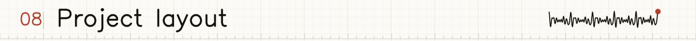

```text
src/parkinvox_src/   feature extraction modules
tests/               unit tests and small test audio
validation/          Praat comparison script and results
scripts/             dataset download scripts
tools/               scripts that generate the images in docs/
docs/                images used in the READMEs (docs/tr/ for Turkish)
```

Run the tests with `pytest`. Downloaded audio, datasets, validation output and trained models are ignored by Git. Please follow each dataset's license and attribution rules.

<br>

<a id="credits"></a>
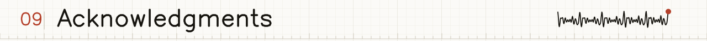

- [Praat](https://www.fon.hum.uva.nl/praat/) and [Parselmouth](https://parselmouth.readthedocs.io/) for the reference measurements
- [VOICED database](https://physionet.org/content/voiced/1.0.0/) on PhysioNet for the validation audio
- [librosa](https://librosa.org/) for audio analysis building blocks
- Hershey vector fonts (public domain) for the lettering in the images
- Generative AI helped write this README and the tests, and helped revise the jitter, shimmer, HNR and formant code.

Made in Van, Türkiye.

<br>


