<p align="center"><a href="README.md">English</a> | Türkçe</p>

<br>

ParkinVox, makine öğrenmesi kullanarak konuşmadan Parkinson hastalığının belirtilerini tespit etmeyi amaçlayan bir projedir. İki aşamada geliştirilmektedir: ses özelliklerini çıkaran ve ölçen bir araç seti ve bu ölçümler üzerinde eğitilen sınıflandırıcılar.

> **Durum: Çalışma devam ediyor.** 1. aşama olan özellik araç seti tamamlandı ve 208 kayıt üzerinde Praat ile doğrulandı. Makine öğrenmesi kısmı henüz tamamlanmadı.

[Kurulum](#install) / [Kullanım](#usage) / [Doğrulama](#validation) / [Sınırlamalar](#limitations) / [Yol haritası](#roadmap)

> **UYARI:** ParkinVox ses sinyallerini ölçer. Parkinson hastalığı teşhisi koymaz ve doktorların yerine kullanılmamalıdır.

<br>

<a id="why"></a>
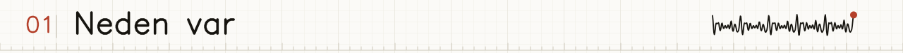

Ses değişiklikleri Parkinson hastalığının erken belirtilerinden biridir ve birçok çalışma bunları jitter, shimmer, HNR ve formantlar gibi özelliklerle inceler. Ancak araçlar bu özellikleri farklı şekillerde hesapladığı için sonuçları karşılaştırmak zordur ve bir sınıflandırıcı, eğitildiği özellikler kadar güvenilirdir.

ParkinVox özelliklerden başlar. Bunları yalnızca NumPy ve librosa ile hesaplar ve her birini fonetikte temel referans araç olan Praat ile karşılaştırır. Sonraki aşamada, herkese açık Parkinson konuşma veri setleri kullanılarak bu ölçümler üzerinde makine öğrenmesi modelleri eğitilecek ve sonuçlar olduğundan iyi görünmesin diye konuşmacı bazında değerlendirilecektir.

<br>

<a id="measures"></a>
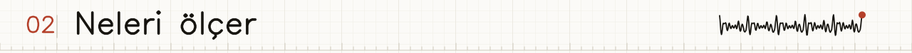

| Grup | Ölçümler | Kayıt görevleri |
|---|---|---|
| Kalite (`qc_`) | tepe ve RMS seviyesi, DC kayması, kırpılma ve sessizlik oranları, kalite bayrakları | tümü |
| Fonasyon (`phon_`) | F0 istatistikleri, jitter (local, RAP, PPQ5), shimmer (local, APQ3/5/11), HNR, CPPS yaklaşığı, şiddet | uzatılmış ünlü |
| Artikülasyon (`art_`) | F1 - F3, MFCC'ler ve delta'ları, spektral ağırlık merkezi, bant genişliği, rolloff, düzlük, ünlü uzayı alanı, VAI, FCR | tümü |
| Doğrusal olmayan (`nonlinear_`) | DFA, permütasyon entropisi, PPE, yineleme oranı ve belirlenimcilik | uzatılmış ünlü |
| Zamanlama (`time_`) | hece çekirdekleri, hece hızı, aralık ortalaması, standart sapma, CV ve eğim | DDK, okuma, spontan konuşma |
| Prozodi (`pros_`) | duraklamalar, F0 aralığı, şiddet aralığı, konuşma hızı, artikülasyon hızı | okuma, spontan konuşma |

Jitter ve shimmer döngü döngü ölçülür. ParkinVox, tek tek glottal döngüleri perde eşzamanlı çapraz korelasyon ve parabolik tepe iyileştirmesiyle izler; Praat'in yaptığı gibi periyot oranı 1,3'ü veya genlik oranı 1,6'yı aşan döngü çiftlerini atlar. HNR, pencere düzeltmeli otokorelasyon kullanır. Formantlar 25 ms'lik çerçevelerde Burg LPC ile hesaplanır ve tavan frekansı kaydın Nyquist frekansıyla sınırlanır.

<br>

<a id="install"></a>
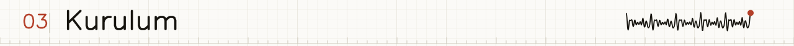

```bash
python -m venv .venv
source .venv/bin/activate
python -m pip install -e ".[test,validation]"
```

Windows'ta `.venv\Scripts\activate` ile etkinleştirin. Python 3.11 veya daha yenisi gerekir.

<br>

<a id="usage"></a>
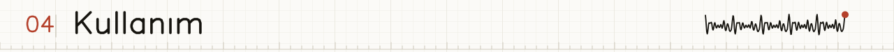

```python
from parkinvox_src import extract_voice_features

features = extract_voice_features("recording.wav", task="sustained_vowel")
print(features["phon_jitter_local"], features["phon_hnr_db"])
```

Desteklenen görevler: `sustained_vowel` (uzatılmış ünlü), `ddk`, `reading` (okuma) ve `spontaneous` (spontan konuşma). Fonksiyon, sayılardan ve bayraklardan oluşan düz bir sözlük döndürür. Bir sonuca güvenmeden önce `qc_` bayraklarını kontrol edin. F0 aralığı ve formant seçenekleri gibi ayarlar `ExtractionConfig` içindedir:

```python
from parkinvox_src import ExtractionConfig, extract_voice_features

config = ExtractionConfig(minimum_f0_hz=60.0, maximum_f0_hz=400.0)
features = extract_voice_features("recording.wav", task="sustained_vowel", config=config)
```

<br>

<a id="validation"></a>
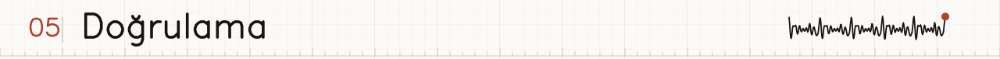

Uzatılmış ünlü ölçümleri, [VOICED veri tabanından](https://physionet.org/content/voiced/1.0.0/) 208 kayıt üzerinde Parselmouth aracılığıyla Praat ile karşılaştırıldı. `validation/validate_praat.py` içindeki tüm kabul kontrolleri geçiyor.

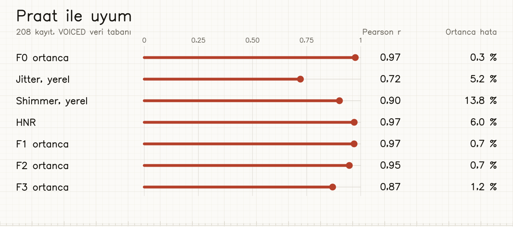

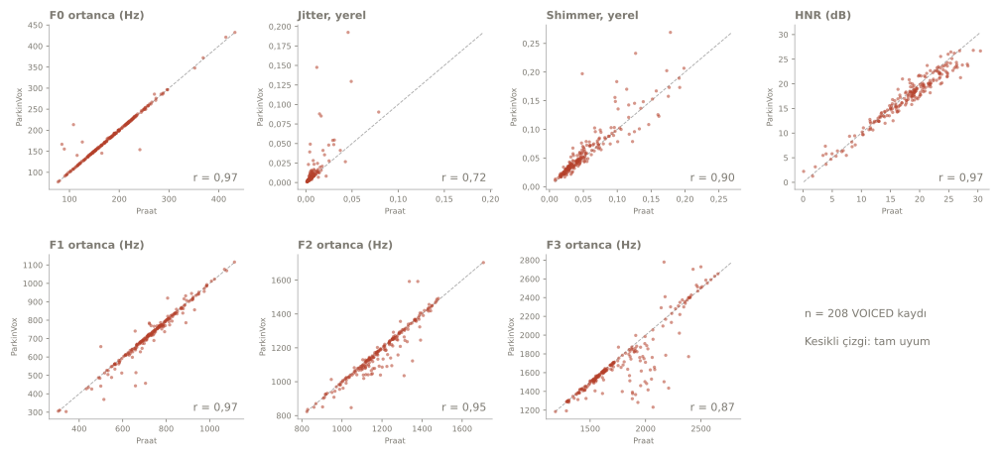

Dosya başına sonuçlar `validation/results/voiced_after_fix.csv` içindedir. Yeniden üretmek için:

```bash
python scripts/download_voiced.py
python validation/validate_praat.py validation_audio --output validation_results.csv
```

<br>

<a id="limitations"></a>
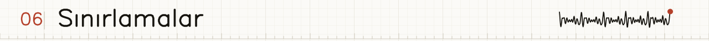

- Doğrulama yalnızca Praat ile uyumu gösterir. Parkinson hastalığını tespit etme konusunda henüz hiçbir şey söylemez ve henüz hiçbir model eğitilmemiştir.
- VOICED sağlıklı ve diğer ses bozukluklarına ait kayıtları içerir, bir Parkinson kohortu içermez.
- Döngü takibinin daha zor olduğu belirgin patolojik seslerde jitter uyumu daha zayıftır (genel r = 0,72, Spearman 0,94).
- VOICED dosyaları 8 kHz olduğu için formant tavanı 4 kHz ile sınırlıdır.
- CPPS değeri yaklaşık bir hesaptır, Praat'in CPPS'inin yerini tutmaz.
- Son modeller herkese açık veri setleriyle eğitilecek ve hastalar üzerinde test edilmemiştir.

<br>

<a id="roadmap"></a>
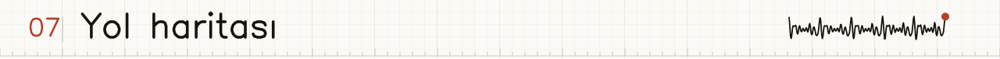

- [x] Uzatılmış ünlü, DDK, okuma ve spontan konuşma için özellik çıkarımı
- [x] Jitter, shimmer, HNR ve formantların Praat ile doğrulanması
- [x] Jitter ve shimmer değerleri bilinen sentetik testler
- [ ] Herkese açık bir Parkinson konuşma veri seti seçip indirme
- [ ] Her kayıt için özellikleri çıkarma ve kayıt koşullarından kaynaklanan karıştırıcı etkileri kontrol etme
- [ ] Konuşmacı bazlı çapraz doğrulama ile sınıflandırıcıları eğitme ve değerlendirme
- [ ] DisVoice gibi diğer açık kaynaklı araç setleriyle karşılaştırma
- [ ] CPPS yaklaşığını doğrulanmış bir uygulamayla değiştirme
- [ ] Sonuçları ve sınırlamaları yazıya dökme

<br>

<a id="layout"></a>
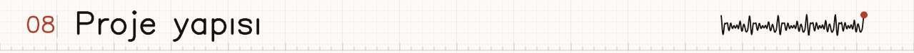

```text
src/parkinvox_src/   özellik çıkarım modülleri
tests/               birim testleri ve küçük test sesleri
validation/          Praat karşılaştırma betiği ve sonuçlar
scripts/             veri seti indirme betikleri
tools/               docs/ içindeki görselleri üreten betikler
docs/                README'lerde kullanılan görseller (docs/tr/ Türkçe olanlar)
```

Testleri `pytest` ile çalıştırın. İndirilen ses dosyaları, veri setleri, doğrulama çıktıları ve eğitilmiş modeller Git tarafından yok sayılır. Lütfen her veri setinin lisansına ve atıf kurallarına uyun.

<br>

<a id="credits"></a>
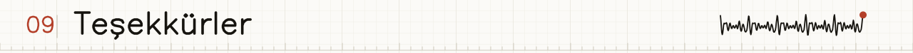

- Referans ölçümler için [Praat](https://www.fon.hum.uva.nl/praat/) ve [Parselmouth](https://parselmouth.readthedocs.io/)
- Doğrulama sesleri için PhysioNet üzerindeki [VOICED veri tabanı](https://physionet.org/content/voiced/1.0.0/)
- Ses analizi yapı taşları için [librosa](https://librosa.org/)
- Görsellerdeki yazılar için Hershey vektör fontları (kamu malı)
- Üretken yapay zekâ bu README'nin ve testlerin yazılmasına, ayrıca jitter, shimmer, HNR ve formant kodunun gözden geçirilmesine yardımcı oldu.

Van, Türkiye'de yapıldı.

<br>

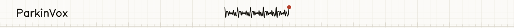
